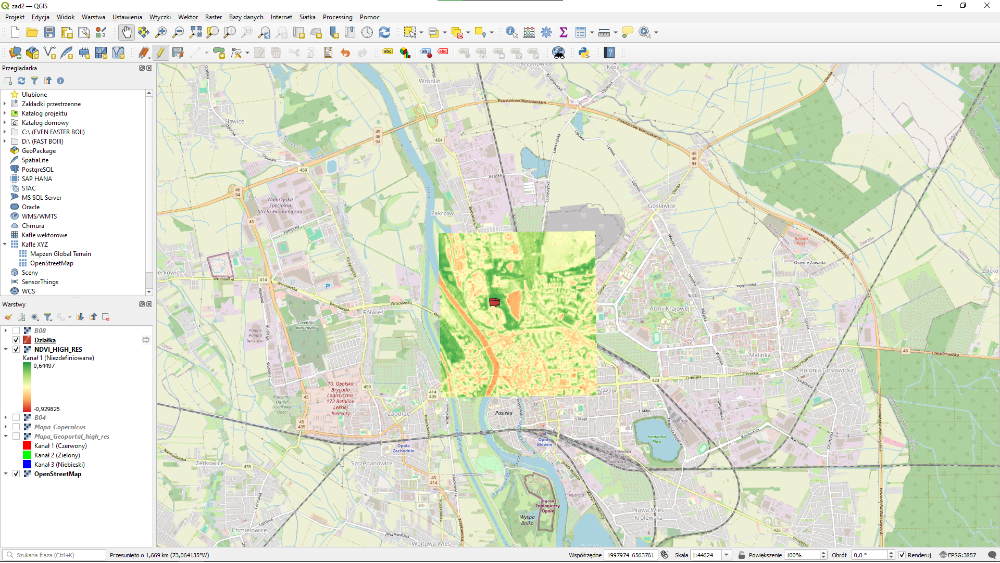
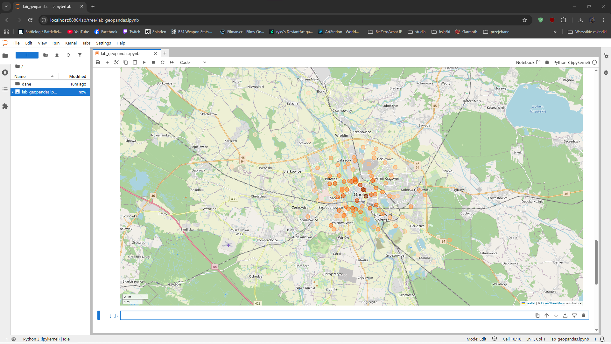

# Program Copernicus - obliczanie NDVI

**Autor:** Gracjan Krzympiec / s102376

## Cel zadania

Obliczenie wskaźnika roślinności NDVI (*Normalized Difference Vegetation Index*) dla wybranego fragmentu terenu na podstawie zobrazowania satelitarnego Sentinel-2 oraz nałożenie wyniku na mapę bazową w programie QGIS.

## Dane

| Element | Wartość |
|---|---|
| Źródło danych | Copernicus (Sentinel-2) |
| Data zobrazowania | 2026-10-03 |
| Użyte kanały | B04 (czerwony), B08 (bliska podczerwień) |
| Obszar | Opole i okolice |
| Mapa bazowa | OpenStreetMap (kafle XYZ) |
| Układ współrzędnych | EPSG:4326 |
| Oprogramowanie | QGIS |

## Wzór

NDVI oblicza się z kanału bliskiej podczerwieni (NIR) i czerwonego (RED):

```
NDVI = (NIR - RED) / (NIR + RED)
```

Dla Sentinel-2: NIR = B08, RED = B04. Wartości mieszczą się w przedziale od -1 do 1.

## Przebieg pracy

1. Pobranie zobrazowania Sentinel-2 dla interesującego obszaru ze strony Copernicus.
2. Wczytanie kanałów B04 i B08 do QGIS (jako warstwy `BO4` i `BO8`).
3. Obliczenie NDVI: **Raster → Kalkulator rastra**, wyrażenie:

   ```
   ("BO8@1" - "BO4@1") / ("BO8@1" + "BO4@1")
   ```

   

4. Ustawienie symbologii warstwy `NDVI`: **Pasmo pojedyncze – pseudokolor**, paleta *green–yellow–red* (zielony = niskie NDVI, czerwony = wysokie).
5. Dodanie mapy bazowej OpenStreetMap i nałożenie warstwy NDVI na wybrany fragment mapy.

## Wynik


Zakres wartości na obliczonej warstwie: od **-0,92** do **0,45**.

## Interpretacja

| Kolor | NDVI | Co oznacza |
|---|---|---|
| Zielony | wysokie | gęsta, zdrowa roślinność (lasy, parki, łąki) |
| Żółty / pomarańczowy | średnie | roślinność rzadka, pola uprawne |
| Czerwony | niskie | gleba odsłonięta, zabudowa, drogi |
| Wartości ujemne | poniżej 0 | woda |

## Wnioski

- Najwyższe wartości NDVI występują w kompleksach leśnych i terenach zieleni, np. w parkach.
- Obszary zabudowane (centrum miasta) oraz drogi mają niskie NDVI.
- Dominacja odcieni czerwieni i pomarańczu wynika z terminu zobrazowania (październik): wiele pól jest już po zbiorach i pozostaje bez roślinności.
- Wskaźnik NDVI dobrze rozróżnia tereny zielone od zabudowanych i odsłoniętej gleby, więc nadaje się do monitorowania stanu roślinności.

## Zawartość paczki

```
├── README.md
├── ndvi_mapa.png
└── kalkulator.png
```
----------------------------------------------------------------------------------------------------------------------------------------------------------------------------------------------------------------------------

# Analiza wysokorozdzielczych danych CIR oraz obliczenie wskaźnika NDVI w programie QGIS

## 1. Cel zadania
Celem zadania było pobranie wysokorozdzielczej ortofotomapy w barwach umownych z wykorzystaniem bliskiej podczerwieni (**CIR – Color Infrared**) dla wybranego obszaru (Opole – okolice Ratusza), wyznaczenie znormalizowanego różnicowego wskaźnika wegetacji (**NDVI**), a następnie przeprowadzenie analizy statystycznej (statystyki strefowej) dla wybranych poligonów testowych reprezentujących różne formy pokrycia terenu.

---

## 2. Wykorzystane dane i narzędzia
* **Oprogramowanie:** QGIS
* **Źródło danych:** Krajowy Geoportal ([geoportal.gov.pl](https://www.geoportal.gov.pl/))
* **Wykorzystany arkusz ortofotomapy:** `M-33-48-D-d-3-4` (aktualność: 13.06.2025 r., kompozycja barwna: CIR)
* **Układ współrzędnych:** `EPSG:2180` (ETRF2000-PL / CS92)

### Charakterystyka kompozycji CIR
W wykorzystanej ortofotomapie CIR kanały spektralne przypisane są w następujący sposób:
* **Kanał 1:** Bliska podczerwień ($NIR$)
* **Kanał 2:** Pasmo czerwone ($Red$)
* **Kanał 3:** Pasmo zielone ($Green$)

Zdrowa roślinność charakteryzuje się silnym odbiciem promieniowania w zakresie bliskiej podczerwieni ($NIR$) oraz silną absorpcją w paśmie czerwonym ($Red$), dzięki czemu na kompozycji CIR odwzorowuje się w intensywnych odcieniach czerwieni.

---

## 3. Przebieg wykonania zadania (Krok po kroku)

### Krok 1: Pozyskanie danych z Geoportalu
1. W serwisie `mapy.geoportal.gov.pl` uruchomiono sekcję **Dane do pobrania** $\rightarrow$ **Ortofotomapa** $\rightarrow$ **Ortofotomapa wg rozdzielczości**.
2. Zlokalizowano obszar centrum Opola (Ratusz) i pobrano arkusz `M-33-48-D-d-3-4` z 2025 roku w kompozycji **CIR** (format GeoTIFF).
3. Pobrany raster wczytano do programu QGIS pod nazwą roboczą `NDVI_HIGH_RES`.

### Krok 2: Obliczenie wskaźnika NDVI
Wskaźnik wegetacji NDVI obliczono zgodnie ze wzorem:

$$NDVI = \frac{NIR - R}{NIR + R}$$

1. Uruchomiono narzędzie **Raster** $\rightarrow$ **Kalkulator rastrów...** (Raster Calculator).
2. Aby uniknąć utraty jakości (przeskalowania wyniku do rozdzielczości warstw satelitarnych Sentinel-2 obecnych w projekcie), zaznaczono na liście pasmo `NDVI_HIGH_RES@1` i użyto opcji **Zasięg z bieżącej warstwy** (Current layer extent), zachowując oryginalną, wysoką rozdzielczość przestrzenną ortofotomapy oraz układ `EPSG:2180`.
3. Wprowadzono formułę obliczeniową uwzględniającą kolejność kanałów w obrazie CIR:
   ```text
   ( "NDVI_HIGH_RES@1" - "NDVI_HIGH_RES@2" ) / ( "NDVI_HIGH_RES@1" + "NDVI_HIGH_RES@2" )
   ```
4. Wygenerowano jednokanałowy raster wynikowy o wartościach mieszczących się w przedziale od $-1$ do $1$.

### Krok 3: Utworzenie warstwy wektorowej (poligonów testowych)
1. Wybrano opcję **Warstwa** $\rightarrow$ **Twórz warstwę** $\rightarrow$ **Nowa warstwa tymczasowa...**
2. Utworzono warstwę poligonową w układzie `EPSG:2180`.
3. Za pomocą narzędzia **Dodaj poligon** zwektoryzowano kilka reprezentatywnych obszarów testowych o różnym pokryciu terenu (np. korony drzew / zieleń miejska, dachy budynków / nawierzchnia rynku, woda).

Poniższy zrzut ekranu przedstawia obliczony wskaźnik `NDVI_HIGH_RES` (w palecie barw od czerwonego do zielonego, zakres wartości od -0,93 do 0,84) nałożony na podkład OpenStreetMap (układ EPSG:2180) wraz z utworzoną warstwą wektorową `Dzialka` reprezentującą badany obszar:



### Krok 4: Obliczenie statystyk strefowych (Zonal Statistics)
1. W panelu **Algorytmy** (Processing Toolbox) uruchomiono narzędzie **Statystyki strefowe** (Zonal Statistics).
2. Jako warstwę wektorową wskazano utworzone poligony testowe, natomiast jako warstwę rastrową – wyliczony wcześniej wysokorozdzielczy wskaźnik NDVI.
3. Wybrano do obliczenia podstawowe miary statystyczne: **średnia** (`mean`), **mediana** (`median`), **minimum** (`min`) oraz **maksimum** (`max`).
4. Wyniki odczytano w tabeli atrybutów nowo powstałej warstwy wektorowej.

---
# Analiza danych przestrzennych w Pythonie – GeoPandas i Rasterio

Repozytorium zawiera realizację laboratorium z analizy danych przestrzennych dla miasta Opola przy użyciu bibliotek `geopandas`, `shapely`, `pandas` oraz `rasterio`.

---

## Spis treści
1. [Konfiguracja środowiska i struktura projektu](#1-konfiguracja-środowiska-i-struktura-projektu)
2. [Część A: Przetwarzanie danych wektorowych w GeoPandas](#2-część-a-przetwarzanie-danych-wektorowych-w-geopandas)
   - [A1. Geometria i GeoDataFrame od zera](#a1-geometria-i-geodataframe-od-zera)
   - [A2. Wczytanie i wstępna inspekcja surowych danych](#a2-wczytanie-i-wstępna-inspekcja-surowych-danych)
   - [A3. Czyszczenie danych pomiarowych](#a3-czyszczenie-danych-pomiarowych)
   - [A4. Konwersja do GeoDataFrame i wizualizacja na mapie](#a4-konwersja-do-geodataframe-i-wizualizacja-na-mapie)

---

## 1. Konfiguracja środowiska i struktura projektu

### Struktura katalogu roboczego
Projekt korzysta z następującej struktury plików:

    lab_geo/
    ├── dane/
    │   ├── pm25_sensors.csv            # Odczyty PM2.5 z czujników w Opolu (dane surowe)
    │   ├── opole_districts.geojson     # Granice 29 dzielnic Opola (OpenStreetMap)
    │   ├── opole_schools.geojson       # Szkoły podstawowe w Opolu (OpenStreetMap)
    │   ├── S2_L2A_2026-10-06_B04.tiff  # Sentinel-2, pasmo B04 - czerwone (Red)
    │   └── S2_L2A_2026-10-06_B08.tiff  # Sentinel-2, pasmo B08 - bliska podczerwień (NIR)
    ├── lab_geopandas.ipynb             # Notatnik z realizacją Części A
    └── README.md                       # Dokumentacja projektu

### Instalacja wymaganych bibliotek
Środowisko wirtualne (`.venv`) zostało skonfigurowane na bazie Pythona 3.11+ z wykorzystaniem pakietów:

    python -m venv .venv
    .venv\Scripts\activate
    pip install geopandas rasterio matplotlib mapclassify folium jupyter streamlit streamlit-folium

Weryfikacja środowiska w notatniku:

    import geopandas as gpd
    import rasterio
    import shapely

    print("geopandas", gpd.__version__)
    print("rasterio ", rasterio.__version__, "| GDAL", rasterio.__gdal_version__)
    print("shapely  ", shapely.__version__)

---

## 2. Część A: Przetwarzanie danych wektorowych w GeoPandas

**Cel analizy:** Wstępne przetworzenie, oczyszczenie i wizualizacja surowych odczytów stężenia pyłu zawieszonego PM2.5 z czujników zlokalizowanych na terenie Opola w celu oceny jakości powietrza w poszczególnych dzielnicach oraz w otoczeniu szkół podstawowych.

### A1. Geometria i GeoDataFrame od zera
Utworzenie podstawowych obiektów geometrycznych (`Point`, `Polygon`) z biblioteki `shapely` oraz zbudowanie tabeli przestrzennej `GeoDataFrame` w geograficznym układzie współrzędnych **EPSG:4326 (WGS 84)**. Zgodnie z konwencją GIS współrzędne przekazywane są w kolejności `(x, y) = (longitude, latitude)`:

    from shapely.geometry import Point, Polygon
    import geopandas as gpd

    rynek = Point(17.9226, 50.6681)
    square = Polygon([(17.92, 50.66), (17.93, 50.66), (17.93, 50.67), (17.92, 50.67)])

    places = gpd.GeoDataFrame(
        {"name": ["Rynek", "Square"]},
        geometry=[rynek, square],
        crs="EPSG:4326",
    )

* **Weryfikacja punktu kontrolnego:** Obiekt `places` posiada układ `EPSG:4326` oraz geometrie typu `Point` i `Polygon`.

---

### A2. Wczytanie i wstępna inspekcja surowych danych
Surowe dane z pliku `dane/pm25_sensors.csv` wczytano jako standardową tabelę `pandas.DataFrame` i poddano analizie jakościowej:

    import pandas as pd

    raw = pd.read_csv("dane/pm25_sensors.csv", parse_dates=["measured_at"])
    raw[["lat", "lon", "pm25"]].describe()
    raw.isna().sum()
    raw.duplicated().sum()

**Wyniki inspekcji zbioru wejściowego (145 wierszy, 5 kolumn):**
* **Duplikaty:** 5 zduplikowanych wierszy.
* **Braki danych (`NaN`):** 3 braki w kolumnie `lat` oraz 4 braki w kolumnie `lon` (w tym 1 w wierszu zduplikowanym).
* **Błędne wartości pomiarowe:** Minimalna wartość `pm25` wynosi `-999` (kod błędu czujnika).
* **Anomalie współrzędnych:** Minimalna wartość `lat` wynosi ok. `17.87`.

> **Wnioski (Pytanie kontrolne A2):**
> *Skąd wzięła się wartość minimalna `lat` ≈ 17,9, skoro Opole leży na szerokości geograficznej ok. 50,7°?*
> Wartość `17.9°` odpowiada długości geograficznej (`lon`) Opola. W części rekordów nastąpiło omyłkowe zamienienie miejscami wartości w kolumnach szerokości (`lat`) i długości geograficznej (`lon`).

---

### A3. Czyszczenie danych pomiarowych
Przeprowadzono czteroetapowy proces czyszczenia danych wraz z raportowaniem liczby rekordów po każdym kroku:

    df = raw.copy()
    report = {"input rows": len(df)}

    # 1. Usunięcie duplikatów
    df = df.drop_duplicates()
    report["after drop_duplicates"] = len(df)

    # 2. Usunięcie wierszy bez współrzędnych geograficznych
    df = df.dropna(subset=["lat", "lon"])
    report["after dropna"] = len(df)

    # 3. Korekta zamienionych współrzędnych (dla Polski: lat 49-55, lon 14-24.5)
    swapped = df["lat"].between(14, 24.5) & df["lon"].between(49, 55)
    df.loc[swapped, ["lat", "lon"]] = df.loc[swapped, ["lon", "lat"]].to_numpy()
    report["swapped rows fixed"] = int(swapped.sum())

    # 4. Odfiltrowanie kodów błędu sensora (-999)
    df = df[df["pm25"] >= 0].reset_index(drop=True)
    report["clean rows"] = len(df)

**Podsumowanie procesu czyszczenia danych:**

| Etap przetwarzania | Liczba wierszy / operacji |
| :--- | :---: |
| Liczba wierszy wejściowych (`input rows`) | **145** |
| Po usunięciu duplikatów (`after drop_duplicates`) | **140** |
| Po odrzuceniu braków współrzędnych (`after dropna`) | **134** |
| Naprawione rekordy z zamienionymi osiami (`swapped rows fixed`) | **3** |
| Liczba poprawnych wierszy po odfiltrowaniu błędów `-999` (`clean rows`) | **130** |

Po czyszczeniu współrzędne `lat` mieszczą się w prawidłowym zakresie `50.62 – 50.77`, a pomiary `pm25` w przedziale `9.0 – 35.0`.

> **Wnioski (Pytanie kontrolne A3):**
> *Dlaczego wiersze z zamienionymi współrzędnymi naprawiono, a wiersze z wartością `-999` usunięto?*
> Wiersze z zamienionymi współrzędnymi zawierały pełną i prawdziwą informację o lokalizacji punktu, zapisaną jedynie w niewłaściwej kolejności kolumn – możliwa była ich bezstratna korekta. Z kolei wartość `-999` oznacza brak odczytu (błąd sprzętowy czujnika), a rzeczywiste stężenie PM2.5 w tym punkcie pozostaje nieznane, dlatego rekordy te należało odfiltrować, aby nie zaniżały wyników analizy.

---

### A4. Konwersja do GeoDataFrame i wizualizacja na mapie
Oczyszczoną tabelę skonwertowano na obiekt `GeoDataFrame` oraz zwizualizowano na interaktywnej mapie podkładowej:

    sensors = gpd.GeoDataFrame(
        df,
        geometry=gpd.points_from_xy(df["lon"], df["lat"]),   # x = lon, y = lat
        crs="EPSG:4326",
    )

    sensors.explore(column="pm25", cmap="Oranges", marker_kwds={"radius": 6})

* **Weryfikacja punktu kontrolnego:**
  * Typ geometrii: `Point`
  * Układ odniesienia (CRS): `EPSG:4326`
  * Zasięg przestrzenny (`total_bounds`): `[17.79, 50.62, 18.02, 50.77]` – wszystkie czujniki poprawnie znajdują się na obszarze Opola.

> **Wnioski (Pytanie kontrolne A4):**
> *Co by się stało po zamianie kolejności argumentów na `points_from_xy(df["lat"], df["lon"])`?*
> Funkcja `points_from_xy(x, y)` interpretuje pierwszy argument jako długość geograficzną (`X`), a drugi jako szerokość geograficzną (`Y`). Przekazanie `lat` (~50.7°) jako długości wschodniej oraz `lon` (~17.9°) jako szerokości północnej spowodowałoby wygenerowanie punktów o współrzędnych ok. **17.9°N, 50.7°E**, przez co wszystkie czujniki wylądowałyby na pustyni na **Półwyspie Arabskim (wschodni Jemen, przy granicy z Omanem i Arabią Saudyjską)**.


