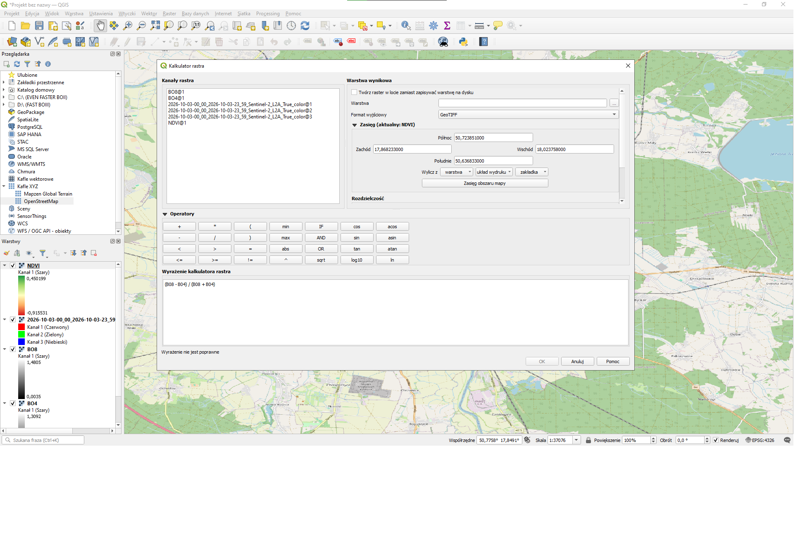
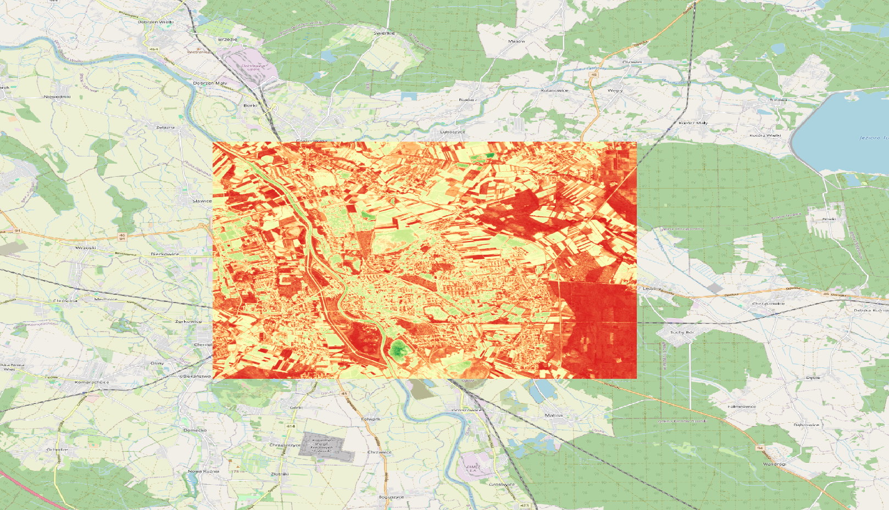
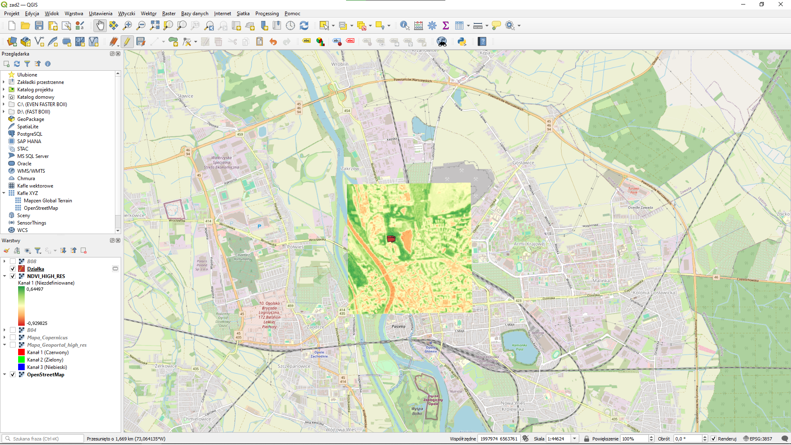
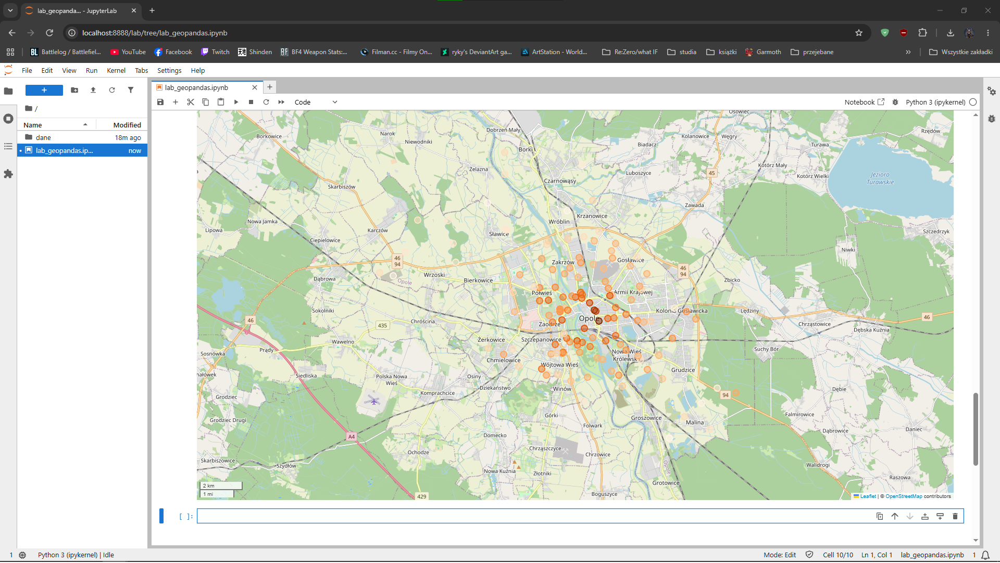
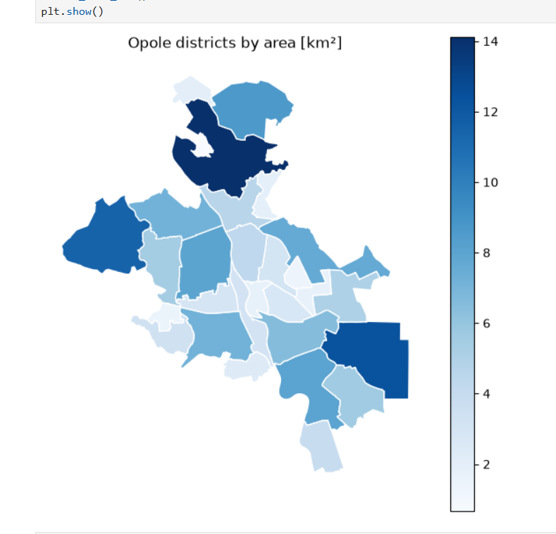

# Program Copernicus - obliczanie NDVI

**Autor:** Gracjan Krzympiec / s102376

## Cel zadania

Obliczenie wskaźnika roślinności NDVI (*Normalized Difference Vegetation Index*) dla wybranego fragmentu terenu na podstawie zobrazowania satelitarnego Sentinel-2 oraz nałożenie wyniku na mapę bazową w programie QGIS.

## Dane

| Element | Wartość |
|---|---|
| Źródło danych | Copernicus (Sentinel-2) |
| Data zobrazowania | 2026-10-03 |
| Użyte kanały | B04 (czerwony), B08 (bliska podczerwień) |
| Obszar | Opole i okolice |
| Mapa bazowa | OpenStreetMap (kafle XYZ) |
| Układ współrzędnych | EPSG:4326 |
| Oprogramowanie | QGIS |

## Wzór

NDVI oblicza się z kanału bliskiej podczerwieni (NIR) i czerwonego (RED):

```
NDVI = (NIR - RED) / (NIR + RED)
```

Dla Sentinel-2: NIR = B08, RED = B04. Wartości mieszczą się w przedziale od -1 do 1.

## Przebieg pracy

1. Pobranie zobrazowania Sentinel-2 dla interesującego obszaru ze strony Copernicus.
2. Wczytanie kanałów B04 i B08 do QGIS (jako warstwy `BO4` i `BO8`).
3. Obliczenie NDVI: **Raster → Kalkulator rastra**, wyrażenie:

   ```
   ("BO8@1" - "BO4@1") / ("BO8@1" + "BO4@1")
   ```

   

4. Ustawienie symbologii warstwy `NDVI`: **Pasmo pojedyncze – pseudokolor**, paleta *green–yellow–red* (zielony = niskie NDVI, czerwony = wysokie).
5. Dodanie mapy bazowej OpenStreetMap i nałożenie warstwy NDVI na wybrany fragment mapy.

## Wynik



Zakres wartości na obliczonej warstwie: od **-0,92** do **0,45**.

## Interpretacja

| Kolor | NDVI | Co oznacza |
|---|---|---|
| Zielony | wysokie | gęsta, zdrowa roślinność (lasy, parki, łąki) |
| Żółty / pomarańczowy | średnie | roślinność rzadka, pola uprawne |
| Czerwony | niskie | gleba odsłonięta, zabudowa, drogi |
| Wartości ujemne | poniżej 0 | woda |

## Wnioski

- Najwyższe wartości NDVI występują w kompleksach leśnych i terenach zieleni, np. w parkach.
- Obszary zabudowane (centrum miasta) oraz drogi mają niskie NDVI.
- Dominacja odcieni czerwieni i pomarańczu wynika z terminu zobrazowania (październik): wiele pól jest już po zbiorach i pozostaje bez roślinności.
- Wskaźnik NDVI dobrze rozróżnia tereny zielone od zabudowanych i odsłoniętej gleby, więc nadaje się do monitorowania stanu roślinności.

## Zawartość paczki

```
├── README.md
├── ndvi_mapa.png
└── kalkulator.png
```
----------------------------------------------------------------------------------------------------------------------------------------------------------------------------------------------------------------------------

# Analiza wysokorozdzielczych danych CIR oraz obliczenie wskaźnika NDVI w programie QGIS

## 1. Cel zadania
Celem zadania było pobranie wysokorozdzielczej ortofotomapy w barwach umownych z wykorzystaniem bliskiej podczerwieni (**CIR – Color Infrared**) dla wybranego obszaru (Opole – okolice Ratusza), wyznaczenie znormalizowanego różnicowego wskaźnika wegetacji (**NDVI**), a następnie przeprowadzenie analizy statystycznej (statystyki strefowej) dla wybranych poligonów testowych reprezentujących różne formy pokrycia terenu.

---

## 2. Wykorzystane dane i narzędzia
* **Oprogramowanie:** QGIS
* **Źródło danych:** Krajowy Geoportal ([geoportal.gov.pl](https://www.geoportal.gov.pl/))
* **Wykorzystany arkusz ortofotomapy:** `M-33-48-D-d-3-4` (aktualność: 13.06.2025 r., kompozycja barwna: CIR)
* **Układ współrzędnych:** `EPSG:2180` (ETRF2000-PL / CS92)

### Charakterystyka kompozycji CIR
W wykorzystanej ortofotomapie CIR kanały spektralne przypisane są w następujący sposób:
* **Kanał 1:** Bliska podczerwień ($NIR$)
* **Kanał 2:** Pasmo czerwone ($Red$)
* **Kanał 3:** Pasmo zielone ($Green$)

Zdrowa roślinność charakteryzuje się silnym odbiciem promieniowania w zakresie bliskiej podczerwieni ($NIR$) oraz silną absorpcją w paśmie czerwonym ($Red$), dzięki czemu na kompozycji CIR odwzorowuje się w intensywnych odcieniach czerwieni.

---

## 3. Przebieg wykonania zadania (Krok po kroku)

### Krok 1: Pozyskanie danych z Geoportalu
1. W serwisie `mapy.geoportal.gov.pl` uruchomiono sekcję **Dane do pobrania** $\rightarrow$ **Ortofotomapa** $\rightarrow$ **Ortofotomapa wg rozdzielczości**.
2. Zlokalizowano obszar centrum Opola (Ratusz) i pobrano arkusz `M-33-48-D-d-3-4` z 2025 roku w kompozycji **CIR** (format GeoTIFF).
3. Pobrany raster wczytano do programu QGIS pod nazwą roboczą `NDVI_HIGH_RES`.

### Krok 2: Obliczenie wskaźnika NDVI
Wskaźnik wegetacji NDVI obliczono zgodnie ze wzorem:

$$NDVI = \frac{NIR - R}{NIR + R}$$

1. Uruchomiono narzędzie **Raster** $\rightarrow$ **Kalkulator rastrów...** (Raster Calculator).
2. Aby uniknąć utraty jakości (przeskalowania wyniku do rozdzielczości warstw satelitarnych Sentinel-2 obecnych w projekcie), zaznaczono na liście pasmo `NDVI_HIGH_RES@1` i użyto opcji **Zasięg z bieżącej warstwy** (Current layer extent), zachowując oryginalną, wysoką rozdzielczość przestrzenną ortofotomapy oraz układ `EPSG:2180`.
3. Wprowadzono formułę obliczeniową uwzględniającą kolejność kanałów w obrazie CIR:
   ```text
   ( "NDVI_HIGH_RES@1" - "NDVI_HIGH_RES@2" ) / ( "NDVI_HIGH_RES@1" + "NDVI_HIGH_RES@2" )
   ```
4. Wygenerowano jednokanałowy raster wynikowy o wartościach mieszczących się w przedziale od $-1$ do $1$.

### Krok 3: Utworzenie warstwy wektorowej (poligonów testowych)
1. Wybrano opcję **Warstwa** $\rightarrow$ **Twórz warstwę** $\rightarrow$ **Nowa warstwa tymczasowa...**
2. Utworzono warstwę poligonową w układzie `EPSG:2180`.
3. Za pomocą narzędzia **Dodaj poligon** zwektoryzowano kilka reprezentatywnych obszarów testowych o różnym pokryciu terenu (np. korony drzew / zieleń miejska, dachy budynków / nawierzchnia rynku, woda).

Poniższy zrzut ekranu przedstawia obliczony wskaźnik `NDVI_HIGH_RES` (w palecie barw od czerwonego do zielonego, zakres wartości od -0,93 do 0,84) nałożony na podkład OpenStreetMap (układ EPSG:2180) wraz z utworzoną warstwą wektorową `Dzialka` reprezentującą badany obszar:



### Krok 4: Obliczenie statystyk strefowych (Zonal Statistics)
1. W panelu **Algorytmy** (Processing Toolbox) uruchomiono narzędzie **Statystyki strefowe** (Zonal Statistics).
2. Jako warstwę wektorową wskazano utworzone poligony testowe, natomiast jako warstwę rastrową – wyliczony wcześniej wysokorozdzielczy wskaźnik NDVI.
3. Wybrano do obliczenia podstawowe miary statystyczne: **średnia** (`mean`), **mediana** (`median`), **minimum** (`min`) oraz **maksimum** (`max`).
4. Wyniki odczytano w tabeli atrybutów nowo powstałej warstwy wektorowej.

---
# Analiza danych przestrzennych w Pythonie – GeoPandas i Rasterio

%%writefile README.md
# Analiza danych przestrzennych w Pythonie – GeoPandas (Część A)

Repozytorium zawiera realizację Części A laboratorium z analizy danych przestrzennych dla miasta Opola przy użyciu bibliotek `geopandas`, `shapely`, `pandas`, `pyproj` oraz `matplotlib`.

---

## Spis treści
1. [Konfiguracja środowiska i struktura projektu](#1-konfiguracja-środowiska-i-struktura-projektu)
2. [A1–A4. Przygotowanie, czyszczenie i wizualizacja danych z czujników](#2-a1a4-przygotowanie-czyszczenie-i-wizualizacja-danych-z-czujników)
3. [A5. Układy współrzędnych (CRS)](#3-a5-układy-współrzędnych-crs)
4. [A6. Analiza poligonów – dzielnice Opola](#4-a6-analiza-poligonów--dzielnice-opola)
5. [A7. Złączenie przestrzenne – jakość powietrza w dzielnicach](#5-a7-złączenie-przestrzenne--jakość-powietrza-w-dzielnicach)
6. [A8. Analiza buforowa – jakość powietrza w pobliżu szkół](#6-a8-analiza-buforowa--jakość-powietrza-w-pobliżu-szkół)
7. [A9. Eksport wyników do plików przestrzennych](#7-a9-eksport-wyników-do-plików-przestrzennych)

---

## 1. Konfiguracja środowiska i struktura projektu

### Struktura katalogu roboczego

    lab_geo/
    ├── dane/
    │   ├── pm25_sensors.csv            # Odczyty PM2.5 z czujników w Opolu (dane surowe)
    │   ├── opole_districts.geojson     # Granice 29 dzielnic Opola (OpenStreetMap)
    │   ├── opole_schools.geojson       # Szkoły podstawowe w Opolu (OpenStreetMap)
    │   ├── S2_L2A_2026-10-06_B04.tiff  # Sentinel-2, pasmo B04 - czerwone (Red)
    │   └── S2_L2A_2026-10-06_B08.tiff  # Sentinel-2, pasmo B08 - bliska podczerwień (NIR)
    │
    ├── wyniki/
    │   ├── pm25.gpkg                   # Wynikowy GeoPackage (warstwy: districts, sensors)
    │   └── pm25_districts.geojson      # Wynikowy GeoJSON (EPSG:4326)
    ├── lab_geopandas.ipynb             # Notatnik z realizacją Części A
    └── README.md                       # Dokumentacja projektu

### Instalacja środowiska
Środowisko wirtualne (`.venv`, Python 3.11+) skonfigurowano w PyCharmie z użyciem następujących pakietów:

    python -m venv .venv
    .venv\Scripts\activate
    pip install geopandas rasterio matplotlib mapclassify folium jupyter streamlit streamlit-folium

---

## 2. A1–A4. Przygotowanie, czyszczenie i wizualizacja danych z czujników

### A1. Geometria i GeoDataFrame od zera
Utworzono podstawowe obiekty `Point` (Rynek w Opolu) i `Polygon` za pomocą `shapely`, zachowując konwencję GIS `(x, y) = (longitude, latitude)`, a następnie zbudowano tabelę `GeoDataFrame` w układzie `EPSG:4326`.

### A2–A3. Inspekcja i czyszczenie pliku `pm25_sensors.csv`
Surowy zbiór danych (145 wierszy, 5 kolumn) poddano czteroetapowemu czyszczeniu:

| Etap przetwarzania | Liczba wierszy / operacji |
| :--- | :---: |
| Liczba wierszy wejściowych (`input rows`) | **145** |
| Po usunięciu duplikatów (`after drop_duplicates`) | **140** |
| Po odrzuceniu braków współrzędnych (`after dropna`) | **134** |
| Naprawione rekordy z zamienionymi osiami `lat`/`lon` (`swapped rows fixed`) | **3** |
| Ostateczna liczba czystych wierszy po odfiltrowaniu błędów `-999` (`clean rows`) | **130** |

> **Wnioski z pytań kontrolnych (A2–A4):**
> * **Anomalia `lat ≈ 17,9`:** Wartość ta odpowiada długości geograficznej (`lon`) Opola – w 3 rekordach kolumny `lat` i `lon` zostały zamienione miejscami.
> * **Naprawa vs usunięcie:** Zamienione współrzędne zawierały pełną informację o lokalizacji (możliwa bezstratna korekta), natomiast `-999` to kod błędu czujnika oznaczający brak rzeczywistego odczytu – rekordy te należało odrzucić.
> * **Konwersja do `GeoDataFrame` (A4):** Po oczyszczeniu wszystkie 130 punktów mieści się w granicach Opola (`total_bounds`: `[17.79, 50.62, 18.02, 50.77]`, `EPSG:4326`). Odwrócenie kolejności argumentów w `points_from_xy(lat, lon)` przeniosłoby wszystkie czujniki w okolice `17.9°N, 50.7°E` (pustynia na Półwyspie Arabskim – wschodni Jemen).



---

## 3. A5. Układy współrzędnych (CRS)

Sprawdzono wpływ układu współrzędnych na obliczenia odległości. Pomiar między dwoma pierwszymi czujnikami (`PM-042` i `PM-106`) w układzie geograficznym `EPSG:4326` zwrócił nieinterpretowalną wartość **`0.0453` stopnia**, natomiast po transformacji do polskiego układu metrycznego **`EPSG:2180` (PUWG 1992)** uzyskano dokładny dystans **`4906.15 m`**.

### Porównanie zniekształceń na odcinku Gdańsk – Zakopane

| Układ współrzędnych | Zmierzona odległość | Błąd względem elipsoidy WGS84 |
| :--- | :---: | :---: |
| Odległość geodezyjna (`pyproj.Geod`) | **569.3 km** | *wartość referencyjna* |
| **EPSG:2180** (PUWG 1992) | **568.9 km** | **-0.07 %** |
| **EPSG:3857** (Web Mercator) | **922.8 km** | **+62.09 %** |

*Wniosek:* Układ `EPSG:3857` nadaje się wyłącznie do wyświetlania kafli map internetowych, ale silnie zniekształca pomiary w średnich szerokościach geograficznych. Obliczenia metryczne dla Polski należy wykonywać w `EPSG:2180`.

---

## 4. A6. Analiza poligonów – dzielnice Opola

Wczytano warstwę wektorową `opole_districts.geojson` (**29 dzielnic**, źródłowy układ `EPSG:4326`), przetransformowano ją do `EPSG:2180` i obliczono powierzchnię w km².

* **Łączna powierzchnia Opola:** **148.8 km²**
* **5 największych dzielnic:**

| Dzielnica | Powierzchnia [km²] |
| :--- | :---: |
| Czarnowąsy | **14.12** |
| Grudzice | **12.34** |
| Wrzoski | **11.46** |
| Świerkle | **8.62** |
| Groszowice | **8.02** |



> **Wnioski (Pytanie kontrolne A6):**
> Policzenie `.area` bez wcześniejszej konwersji `to_crs("EPSG:2180")` zwróciłoby wynik w **stopniach kwadratowych**, co nie ma fizycznego sensu (długość stopnia długości geograficznej zależy od szerokości). GeoPandas zabezpiecza użytkownika, wyświetlając wtedy ostrzeżenie `UserWarning: Geometry is in a geographic CRS`.

---

## 5. A7. Złączenie przestrzenne – jakość powietrza w dzielnicach

Za pomocą `gpd.sjoin(..., predicate="within")` przypisano wszystkie 130 czujników do odpowiadających im dzielnic (0 rekordów bez przypisanej dzielnicy). Po odfiltrowaniu dzielnic z minimum 3 czujnikami wyznaczono obszary o najwyższym średnim stężeniu PM2.5:

| Dzielnica | Średnie PM2.5 [µg/m³] | Liczba czujników |
| :--- | :---: | :---: |
| **Stare Miasto** | **29.6** | 3 |
| **Śródmieście** | **26.8** | 7 |
| **Zaodrze** | **22.5** | 6 |


> **Wnioski (Pytanie kontrolne A7):**
> Zamiana `predicate="within"` na `predicate="intersects"` nie zmienia wyników dla punktów leżących wewnątrz poligonów. Różnica pojawiłaby się w przypadku czujnika leżącego dokładnie na granicy dzielnic (`within` odrzuciłoby punkt, a `intersects` przypisałoby go do obu sąsiednich dzielnic) lub przy łączeniu geometrii liniowych/poligonowych przecinających granice.

---

## 6. A8. Analiza buforowa – jakość powietrza w pobliżu szkół

Wczytano warstwę 19 szkół podstawowych (`opole_schools.geojson`, konwersja do `EPSG:2180`) i wyznaczono wokół nich strefy buforowe o promieniu **500 m** oraz porównawczo **1500 m**.

| Parametr analizy | Wynik |
| :--- | :---: |
| Całkowita liczba szkół podstawowych | **19** |
| Szkoły z czujnikiem w promieniu **500 m** | **11** |
| Średnie stężenie PM2.5 w promieniu 500 m od szkół | **22.3 µg/m³** |
| Pokrycie powierzchni miasta buforami 500 m | **9.5 %** |
| Szkoły z czujnikiem w promieniu **1500 m** | **19** (100%) |


> **Wnioski (Pytanie kontrolne A8):**
> Zwiększenie promienia bufora do 1500 m obejmuje czujnikami wszystkie **19 szkół**. Wywołanie `buffer(1500)` bezpośrednio na danych w układzie `EPSG:4326` byłoby błędem krytycznym – jednostką w tym układzie są stopnie, więc powstałyby okręgi o promieniu **1500 stopni** (wielokrotnie przekraczające wymiary całej kuli ziemskiej).

---

## 7. A9. Eksport wyników do plików przestrzennych

Wyniki zapisano w katalogu `wyniki/` w dwóch standardowych formatach GIS:
* **`wyniki/pm25.gpkg`** (GeoPackage, układ `EPSG:2180`) – zawiera dwie warstwy: `districts` (29 poligonów ze statystykami PM2.5) oraz `sensors` (130 oczyszczonych punktów pomiarowych).
* **`wyniki/pm25_districts.geojson`** (GeoJSON, układ `EPSG:4326`) – format gotowy do wykorzystania w aplikacjach webowych.

Poprawność zapisu zweryfikowano za pomocą `gpd.list_layers()` oraz ponownego wczytania warstwy `districts` (29 wierszy, `EPSG:2180`).
