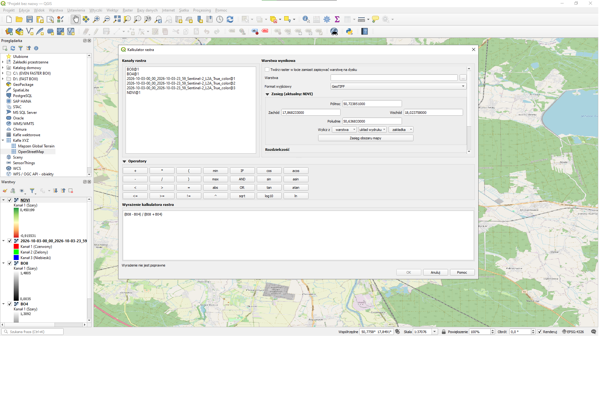
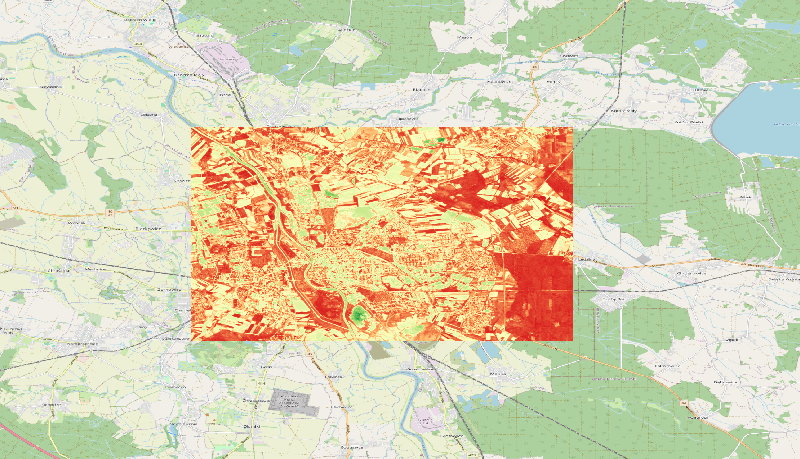

# Program Copernicus - obliczanie NDVI

**Autor:** Gracjan Krzympiec / s102376

## Cel zadania

Obliczenie wskaźnika roślinności NDVI (*Normalized Difference Vegetation Index*) dla wybranego fragmentu terenu na podstawie zobrazowania satelitarnego Sentinel-2 oraz nałożenie wyniku na mapę bazową w programie QGIS.

## Dane

| Element | Wartość |
|---|---|
| Źródło danych | Copernicus (Sentinel-2) |
| Data zobrazowania | 2026-10-03 |
| Użyte kanały | B04 (czerwony), B08 (bliska podczerwień) |
| Obszar | Opole i okolice |
| Mapa bazowa | OpenStreetMap (kafle XYZ) |
| Układ współrzędnych | EPSG:4326 |
| Oprogramowanie | QGIS |

## Wzór

NDVI oblicza się z kanału bliskiej podczerwieni (NIR) i czerwonego (RED):

```
NDVI = (NIR - RED) / (NIR + RED)
```

Dla Sentinel-2: NIR = B08, RED = B04. Wartości mieszczą się w przedziale od -1 do 1.

## Przebieg pracy

1. Pobranie zobrazowania Sentinel-2 dla interesującego obszaru ze strony Copernicus.
2. Wczytanie kanałów B04 i B08 do QGIS (jako warstwy `BO4` i `BO8`).
3. Obliczenie NDVI: **Raster → Kalkulator rastra**, wyrażenie:

   ```
   ("BO8@1" - "BO4@1") / ("BO8@1" + "BO4@1")
   ```

   

4. Ustawienie symbologii warstwy `NDVI`: **Pasmo pojedyncze – pseudokolor**, paleta *green–yellow–red* (zielony = niskie NDVI, czerwony = wysokie).
5. Dodanie mapy bazowej OpenStreetMap i nałożenie warstwy NDVI na wybrany fragment mapy.

## Wynik



Zakres wartości na obliczonej warstwie: od **-0,92** do **0,45**.

## Interpretacja

| Kolor | NDVI | Co oznacza |
|---|---|---|
| Zielony | wysokie | gęsta, zdrowa roślinność (lasy, parki, łąki) |
| Żółty / pomarańczowy | średnie | roślinność rzadka, pola uprawne |
| Czerwony | niskie | gleba odsłonięta, zabudowa, drogi |
| Wartości ujemne | poniżej 0 | woda |

## Wnioski

- Najwyższe wartości NDVI występują w kompleksach leśnych i terenach zieleni, np. w parkach.
- Obszary zabudowane (centrum miasta) oraz drogi mają niskie NDVI.
- Dominacja odcieni czerwieni i pomarańczu wynika z terminu zobrazowania (październik): wiele pól jest już po zbiorach i pozostaje bez roślinności.
- Wskaźnik NDVI dobrze rozróżnia tereny zielone od zabudowanych i odsłoniętej gleby, więc nadaje się do monitorowania stanu roślinności.

## Zawartość paczki

```
├── README.md
├── ndvi_mapa.png
└── kalkulator.png
```
